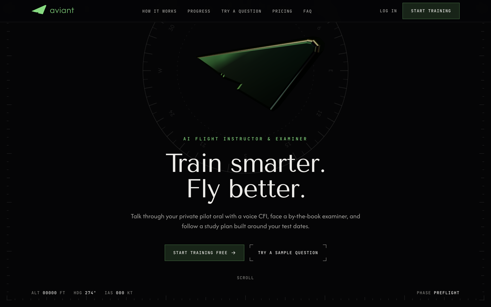

<p align="center">
  
</p>

<h1 align="center">Aviant</h1>

<p align="center">
  <strong>An AI flight instructor and examiner for student pilots.</strong><br />
  Talk through the private pilot oral, drill the knowledge test, and follow a study plan built around your test dates.
</p>

<p align="center">
  <a href="https://aviantapp.com"><strong>aviantapp.com</strong></a>
  &nbsp;·&nbsp;
  <a href="mailto:aviantsupport@aviantapp.com">Support</a>
</p>

<p align="center">
  
</p>

---

## What it is

Most of checkride prep happens alone, between lessons, and the oral exam is the part you can't cram from a book. Aviant gives student
pilots two voices on demand:

- **A CFI** (Teach mode) that explains concepts out loud, answers follow-up questions, and quizzes you until it sticks.
- **A DPE** (Examine mode) that asks scenario-based oral questions, probes weak answers, and grades every response against the FAA
  Airman Certification Standards (ACS).

Around those two voices sits everything else a student needs to get from first lesson to checkride day: a question bank, timed mock
knowledge tests, spaced-repetition review, a personalized study plan, and a readiness score that says when you are actually prepared.

> Aviant is a study aid. It does not replace instruction from an authorized flight instructor, an FAA-designated pilot examiner, or
> official FAA publications.

## Features

| | |
|---|---|
| **Voice CFI & DPE** | One assistant, two modes. Streams its reply sentence by sentence through natural ElevenLabs voices, supports interruptions and hands-free conversation. |
| **Graded orals** | Each answer is scored against ACS key points, with a debrief of what was covered, what was missed, and the reference to study. |
| **Full mock checkride** | Upload your own cross-country plan and aircraft POH; the examiner questions you on *your* weather, performance, weight and balance, and go/no-go call. |
| **Knowledge test prep** | 306 practice questions across every area, drawn fresh each attempt with shuffled answers, plus timed full-length mock tests. |
| **Spaced repetition** | Missed questions come back first; known ones are scheduled further out, as a quiz or as flashcards. |
| **Personalized study plan** | Onboarding and a 24-question diagnostic produce a daily session sized to your available time, weighted toward weak topics, and re-planned as you study. |
| **Readiness & incentives** | Readiness score, predicted written score, streaks, XP and pilot ranks, badges, weekly challenges, a logbook, and a printable *Aviant Ready* certificate for your CFI. |

Private Pilot (Airplane) is supported today. Instrument Rating is coming soon.

## Tech stack

- **Framework:** [Next.js 16](https://nextjs.org) (App Router, Server Actions, React 19)
- **Styling:** Tailwind CSS v4 with design tokens, light and dark themes
- **Motion & 3D:** Motion, Three.js via React Three Fiber, Lenis smooth scrolling
- **AI:** Anthropic Claude (structured, streamed examiner turns with prompt caching and the Files API for checkride documents)
- **Voice:** ElevenLabs text-to-speech, browser speech recognition
- **Data & auth:** Supabase (Postgres with row-level security, Auth, Storage)
- **Hosting:** Vercel

## Getting started

**Requirements:** Node.js 20+ and a Supabase project. Claude and ElevenLabs keys are optional for local development; without them the app
falls back to a sample examiner engine and the browser's built-in voice.

```bash
git clone git@github.com:pranjalp970/aviant.git
cd aviant
npm install
cp .env.example .env.local   # then fill in the values
npm run dev                  # http://localhost:3000
```

### Environment variables

| Variable | Required | Purpose |
|---|---|---|
| `NEXT_PUBLIC_SUPABASE_URL` | Yes | Supabase project URL |
| `NEXT_PUBLIC_SUPABASE_PUBLISHABLE_KEY` | Yes | Supabase publishable key |
| `ANTHROPIC_API_KEY` | No | Enables the Claude examiner and tutor |
| `ELEVENLABS_API_KEY` | No | Natural voices for the CFI and DPE |
| `AI_DAILY_REPLY_LIMIT`, `TTS_DAILY_CHAR_LIMIT` | No | Per-student daily caps on paid services |
| `NEXT_PUBLIC_SITE_URL`, `NEXT_PUBLIC_SUPPORT_EMAIL` | No | Public site address and support contact |

Never commit `.env.local`; it is git-ignored.

### Database

In the Supabase SQL editor, run `supabase/schema.sql`, then each file in `supabase/migrations/` in order. Every table uses row-level
security, and writes that need server-side checks (usage limits, study logging, account deletion) go through security-definer functions.
In **Authentication → URL Configuration**, set the Site URL and add `<site>/**` to the redirect URLs.

## Project structure

```
src/
  app/
    (marketing)/     Public home page and legal pages
    (auth)/          Log in, sign up, password reset
    onboarding/      Study-plan wizard and diagnostic
    portal/          Dashboard, voice assistant, quizzes, review, study guides,
                     study plan, mock checkride, logbook, certificate, settings
    api/             Assistant (streaming) and text-to-speech routes
  components/        UI, grouped by area (marketing, portal, plan, progress, …)
  content/           ACS areas, question bank, lessons, quizzes
  lib/
    ai/              Claude provider, sample engine, streaming JSON helpers
    plan/            Pure study-plan engine
    progress/        Streaks, XP, badges, challenges
    supabase/, auth/ Clients, session, server actions
supabase/            Schema, migrations, branded email templates
```

## Scripts

| Command | |
|---|---|
| `npm run dev` | Start the development server |
| `npm run build` | Production build |
| `npm run start` | Serve the production build |
| `npm run lint` | Lint with ESLint |

## Deployment

Production runs on Vercel at [aviantapp.com](https://aviantapp.com). Set the same environment variables in the Vercel project, then deploy:

```bash
npx vercel deploy --prod
```

## Contact

Questions or feedback: [aviantsupport@aviantapp.com](mailto:aviantsupport@aviantapp.com)

---

<sub>© 2026 Aviant. All rights reserved. Aviant is not affiliated with the FAA.</sub>
